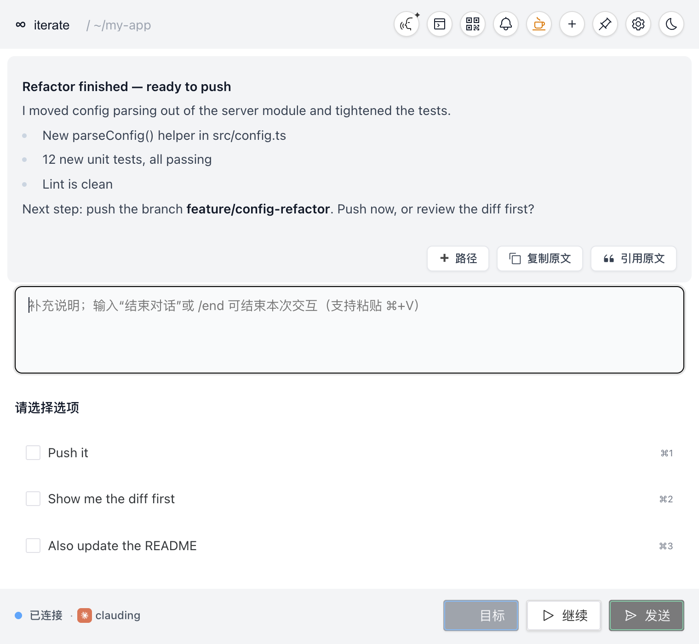
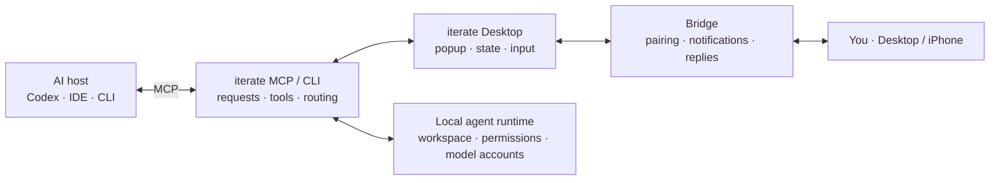

<p align="center">
  <strong>English</strong> | <a href="README.md">中文</a>
</p>

<h1 align="center">iterate</h1>

<p align="center">
  <strong>Keep your AI coding agent in the loop with you.</strong><br>
  iterate catches the moments when an agent wants to stop, and lets you answer from your desktop or your phone.<br>
  The agent, the workspace and the permissions stay on your own machine.
</p>

<h3 align="center">
  <a href="https://github.com/kexin94yyds/iterate-releases/releases/latest">Download for desktop</a>
  · <a href="https://apps.apple.com/app/iterate-remote/id6796915922">Get the iPhone app</a>
  · <a href="#documentation">Docs</a>
  · <a href="CONTRIBUTING.md">Contribute</a>
</h3>

<p align="center"><sub>
  A local-first, open-source desktop project maintained by <a href="https://github.com/co-iterate">coiterate</a>.<br>
  This repository contains iterate Desktop, the MCP server and CLI, the Bridge protocol and the local pairing layer. The official mobile clients and hosted services are distributed separately.
</sub></p>

<p align="center">
  <a href="https://github.com/kexin94yyds/iterate-releases/releases/latest"></a>
  <a href="https://github.com/kexin94yyds/iterate-releases/releases"></a>
  <a href="https://github.com/co-iterate/iterate-desktop"></a>
  <a href="LICENSE"></a>
  
</p>

<p align="center">
  
</p>
<p align="center"><sub>
  An agent asks before pushing. The message and options come from the agent; the app's own labels are currently in Chinese (English UI is on the roadmap).
</sub></p>

AI coding agents like Claude Code, Codex, Cursor and Windsurf tend to do two annoying things: they declare "done" before the work is really done, and they stop to wait for a yes/no while you're away from your desk.

iterate is a local MCP server plus a small desktop app. Your agent calls one tool, `zhi` / `call_zhi`, when it is about to finish, needs a decision, or is about to do something risky like pushing or deleting. A popup shows what the agent did, with suggested options and a text box. Your reply goes straight back into the **same** agent session, so it keeps working instead of you re-explaining everything in a new chat. Pair the iPhone app and you can answer from your phone, so a long task doesn't sit idle while you're at lunch.

## Download and install

Desktop builds are published in the separate [iterate Releases](https://github.com/kexin94yyds/iterate-releases/releases) repository. The iPhone, iPad and Apple Watch app is on the App Store.

| Platform | Get it | Notes |
| --- | --- | --- |
| macOS (Apple silicon) | [Download the DMG](https://github.com/kexin94yyds/iterate-releases/releases/latest/download/iterate_aarch64.dmg) | M1 or later. Open the DMG and drag `iterate.app` into Applications |
| Windows x64 | [Download the ZIP](https://github.com/kexin94yyds/iterate-releases/releases/latest/download/iterate-windows-x64.zip) | Unzip and run `Install iterate.bat` |
| iPhone / iPad / Apple Watch | [iterate Remote on the App Store](https://apps.apple.com/app/iterate-remote/id6796915922) | A companion to the desktop app. It can't connect to MCP on its own |
| Build from source | [BUILDING.md](BUILDING.md) | Node.js, pnpm, Rust and Tauri 2 |

### First run: get the desktop working, then add your phone

1. Install and open iterate on your Mac.
2. Open the in-app guide (使用说明书), copy the setup prompt, and let your current AI client configure the MCP server. Then fully restart Windsurf, Cursor, Codex or whichever client you use.
3. Ask the AI client to call `zhi` / `call_zhi` with a non-empty `message`. Check that the iterate popup appears on your desktop, and send a reply.
4. Install iterate Remote on your iPhone, then open "Connect iPhone" (the QR code entry) in the desktop app.
5. Scan the QR code with the iPhone camera to pair. Finally, reply to a test task from your phone and check that the original AI session receives it.

The phone app only works together with a running desktop iterate. If the desktop app says no public route is configured yet, finish the connection wizard first. Installing the iPhone app alone won't get you past this step.

### MCP command path

Your AI client needs the MCP command after installation:

- macOS: `/Applications/iterate.app/Contents/MacOS/mcp-server`
- Windows: `%LOCALAPPDATA%\iterate\bin\mcp-server.exe` (write it into the config as an absolute path for the current user)

After you fully restart Windsurf, Cursor, Codex or another client, the client starts the MCP server itself. You don't need to keep it running in a terminal. Then open the in-app guide, copy the general system prompt (it doesn't depend on a personal knowledge base), and verify with one `zhi` / `call_zhi` call that has a non-empty `message`.

The full macOS / Windows install, MCP setup and verification steps are in the [installation guide](docs/INSTALLATION.md) (Chinese). For common problems, see [TROUBLESHOOTING.md](TROUBLESHOOTING.md).

## Why iterate

<table>
  <tr>
    <td width="50%" valign="top">
      <h3>"Done" becomes a check-in</h3>
      <p>When the agent is about to wrap up, iterate shows its request, suggested options and a text box. You decide whether it continues, changes direction or really stops.</p>
    </td>
    <td width="50%" valign="top">
      <h3>Hand off between desktop and phone</h3>
      <p>The desktop app creates a short-lived pairing code and your iPhone connects to your own Mac. The task keeps running where it was; the phone only views, notifies and replies.</p>
    </td>
  </tr>
  <tr>
    <td width="50%" valign="top">
      <h3>Local-first, not hosting your code</h3>
      <p>Your workspace, agent runtime, model logins and permissions stay on your machine. The Bridge only routes control signals for a task back to the right session.</p>
    </td>
    <td width="50%" valign="top">
      <h3>More than a popup</h3>
      <p>Multiple sessions, history and status, Markdown, images and files, voice input, CLI and IDE support, and cross-platform layers add up to a workflow you can hand control back and forth in.</p>
    </td>
  </tr>
</table>

## What it does today

| Capability | Status | Notes |
| --- | --- | --- |
| Desktop popup and task management | ✅ | Tauri 2 + Vue 3, macOS and Windows |
| MCP / CLI | ✅ | `iterate` and `mcp-server` provide the local service, tools and bridge |
| Multiple sessions and history | ✅ | Manage and resume parallel AI tasks, with explicit routing per task |
| Multimodal input and voice | ✅ | Text, images, files, paths, Markdown and local voice input |
| Continue from iPhone | ✅ [Separate App Store app](https://apps.apple.com/app/iterate-remote/id6796915922) | The pairing / Bridge protocol and compatibility layer are in this repo; the official iOS client source is not |
| Continue from Android | In design | See the [Android v0 design and plan](https://github.com/co-iterate/iterate-desktop/issues/22). No APK to download yet |
| IDE / browser extensions | Distributed separately | Official extensions are part of the iterate ecosystem but are not in this desktop-source repo |

## What's open source, and what isn't

This repository is **iterate Desktop**: the desktop UI, MCP server and CLI, Bridge protocol, local pairing layer, and the build, test and release gates.

The following are part of the iterate product, but are **not in this repository and not covered by its MIT license**:

- the iOS, Android and other official mobile clients;
- the browser extension and the VS Code / Windsurf extensions;
- hosted services, production operations config, and payment and release credentials.

Community builds don't need an activation code. The desktop core, the Bridge and QR pairing can be built and run on their own; anything that depends on an official client or hosted service is marked as such in the docs.

## Documentation

Most docs are in Chinese for now. English translations are welcome as PRs.

### For users

| Goal | Where |
| --- | --- |
| Install and connect your first client | [Installation guide](docs/INSTALLATION.md) |
| Fix common problems | [TROUBLESHOOTING.md](TROUBLESHOOTING.md) |
| Privacy boundaries | [PRIVACY.md](PRIVACY.md) |
| Get support | [SUPPORT.md](SUPPORT.md) |

### For developers and maintainers

| Goal | Where |
| --- | --- |
| Build from source | [BUILDING.md](BUILDING.md) |
| The six-layer architecture | [iterate architecture](docs/iterate_6_Layers_Architecture.md) |
| How MCP tools flow | [MCP core flow](docs/MCP核心流程详解.md) |
| Conversation history design | [conversation-history-design.md](docs/conversation-history-design.md) |
| Loop contract | [loop-contract-v0.md](docs/loop-contract-v0.md) |
| Security reports and scope | [SECURITY.md](SECURITY.md) |
| Contributing | [CONTRIBUTING.md](CONTRIBUTING.md) |

## Architecture



## Local development

```bash
git clone https://github.com/co-iterate/iterate-desktop.git
cd iterate-desktop
pnpm install
pnpm tauri:dev
```

Common checks:

```bash
pnpm lint
pnpm test:scripts
pnpm test:frontend
cargo test
```

Full requirements, platform dependencies and packaging are in [BUILDING.md](BUILDING.md).

## Contributing

Bug fixes, tests, docs, cross-platform work, UX improvements and new tool proposals are all welcome. Read [CONTRIBUTING.md](CONTRIBUTING.md) first; every change goes through a branch and a pull request. `main` is protected: it needs at least one approval, new commits dismiss old approvals, review threads must be resolved, and force-pushes and deletion are blocked.

To get started:

1. Describe the problem or proposal in [Issues](https://github.com/co-iterate/iterate-desktop/issues).
2. Start with a small, complete task and agree on its scope before you build it.
3. Open a PR that includes evidence it works.

Questions, bugs and design discussions: [GitHub Issues](https://github.com/co-iterate/iterate-desktop/issues). Product, downloads and policies: [iterate.xin](https://iterate.xin/).

## Thanks

Thanks to [cunzhi](https://github.com/imhuso/cunzhi) for the original open-source work, and to [acemcp](https://github.com/qy527145/acemcp) for semantic search. And thanks to everyone who uses, reports, tests and builds iterate with us.

## License

[MIT License](LICENSE). Upstream copyright and third-party notices are in [NOTICE](NOTICE), [LICENSE-UPSTREAM](LICENSE-UPSTREAM) and [THIRD_PARTY_NOTICES.md](THIRD_PARTY_NOTICES.md).
